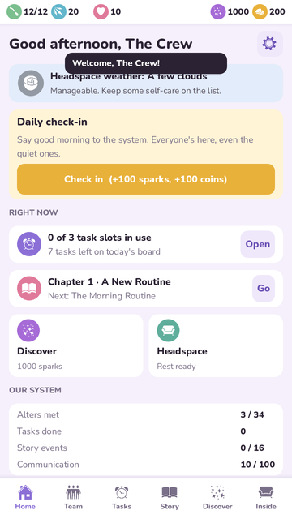
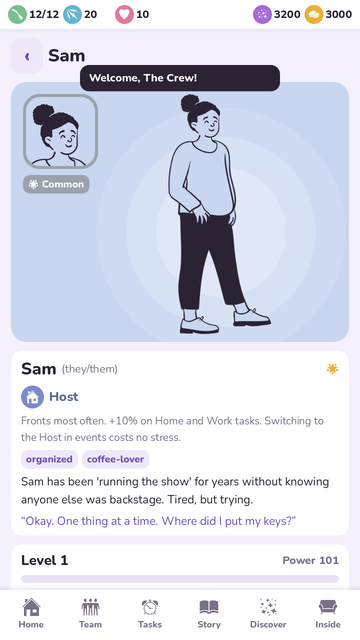
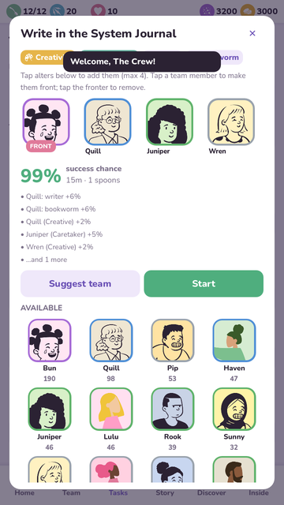
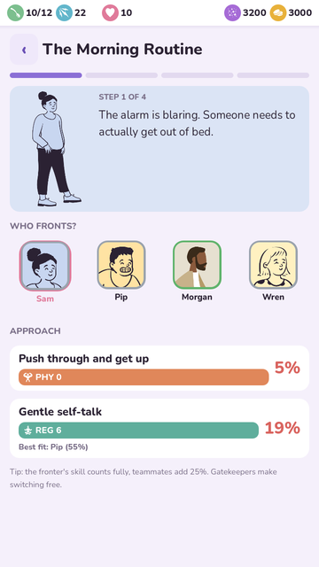
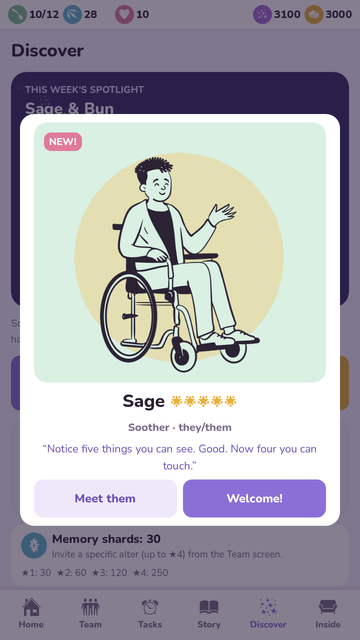
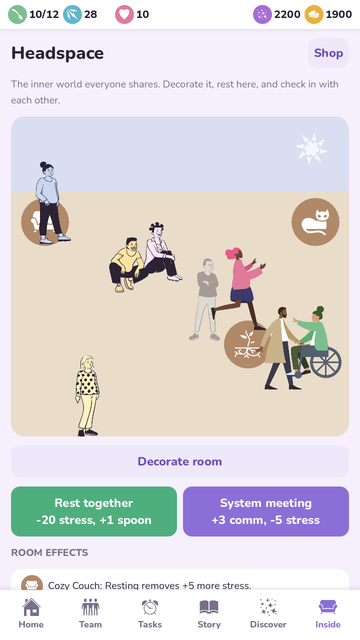

# Many Hands *(working title)*

A cozy team-building gacha game for Android about a plural system (DID/OSDD) getting through daily life together. Build a team of alters, match the right skills to each task, and help everyone grow.

<p>
  
  
</p>

## Install on your phone

1. Download [`builds/ManyHands.apk`](builds/ManyHands.apk) on your Android phone (GitHub: open the file and tap **Download raw file**).
2. Open it. If Android asks, allow your browser or file manager to **install unknown apps**.
3. Tap **Install**. Requires Android 7.0 or newer.

There are no ads, accounts, network access or real-money purchases. Progress is saved on the device. Use **Settings › Backup** to copy a backup code you can keep in a note or cloud drive.

## What's in the game

| System | Description |
|---|---|
| **Alters** | 34 alters, 5 rarity tiers, 12 roles (Host, Protector, Caretaker, Little, Gatekeeper, Manager, Social, Soother, Creative, Memory Holder, Fictive, Teen) and personality traits. Every alter is drawn as a full-body character (Open Peeps or Humaaans style), and their headshot is cropped from that same art. |
| **Skills** | Social, Organization, Physical, Regulation, Focus, Creativity. Each is a base value plus a random roll range, in the style of Star Trek Timelines. |
| **Tasks** | Real-time chores from a daily board, similar to shuttle missions. Pick up to 4 alters and choose who fronts. The fronter's skills count fully and teammates add 35%. Traits, roles, bonds, communication and stress all change the success chance. |
| **Story** | 6 chapters and 16 multi-step events, similar to away missions. At each step you choose an approach and who fronts. Switching fronters costs stress unless a Gatekeeper is on the team. Each event gives up to 3 stars. Content notes appear before heavier topics. |
| **Discover** | Gacha using sparks earned in-game. Rates are 2/8/20/30/40%. A ★4 is guaranteed within 10 pulls and a ★5 within 60. A weekly spotlight boosts one ★5 and one ★4. Duplicates raise star rank; at max stars they give memory shards, which can buy specific alters. |
| **Growth** | Levels 1–50 and star ranks. Bonds grow between alters who work together. Each alter has 2 slots for comfort items, out of 24 items. |
| **Resources** | Spoons are energy (regenerate over time). Stress makes tasks harder above 50 and powers up Protectors. System communication gives a team-wide bonus. |
| **Headspace** | A decoratable room where your alters wander. Rest there to lower stress, hold a daily system meeting, and buy 18 decor pieces that give passive bonuses. |
| **Care** | Content-note toggle, a support resources page, reduced-motion setting and cosmetic customization (name, pronouns, and 30 alternate full-body looks). |

## Project layout

```
game/                 Godot 4.4 project (GDScript)
  data/*.json         All content: alters, chores, story, items, roles
  scripts/game.gd     Rules & save state (autoload "Game")
  scripts/db.gd       Data loading (autoload "DB")
  scripts/ui/         Code-built UI screens
  assets/             Full-body art + cropped headshots, icons, fonts
  tests/              Headless logic tests + screenshot harness
tools/                Art generation scripts
builds/               Signed APK
```

## Building

Requires [Godot 4.4.1](https://godotengine.org) with Android export templates, plus a JDK and Android build-tools (apksigner).

```sh
# logic tests
godot --headless --path game -s tests/test_logic.gd
# screenshots of every screen (needs a display, e.g. xvfb-run)
godot --path game --rendering-driver opengl3 res://tests/screenshots.tscn -- /tmp/shots
# APK
GODOT_ANDROID_KEYSTORE_RELEASE_PATH=... GODOT_ANDROID_KEYSTORE_RELEASE_USER=... GODOT_ANDROID_KEYSTORE_RELEASE_PASSWORD=... \
  godot --headless --path game --export-release Android ../builds/ManyHands.apk
```

To regenerate art, install the npm packages listed at the top of `tools/gen_art.js`, then run `node tools/gen_art.js game && python3 tools/crop_bodies.py game`.

## Credits

See [CREDITS.md](CREDITS.md). All art is used under licenses that allow commercial use.

## A note

This game is a gentle, fictional take on living as a system. It isn't therapy or a diagnostic tool, and every system is different.
